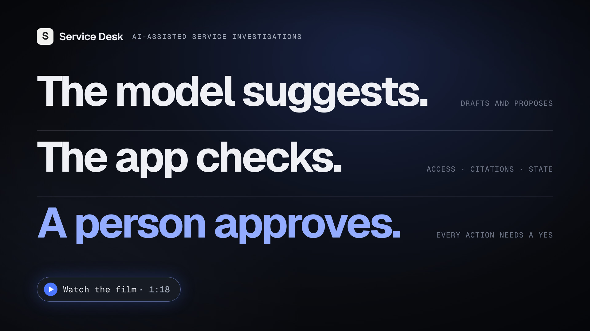
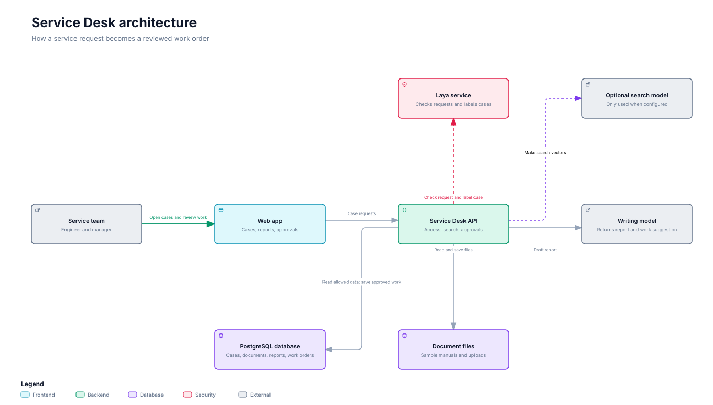

<div align="center">

<h1>Service Desk</h1>

<p><strong>An AI assistant for field service teams that cites its sources, stops unsafe requests before they reach a model, and never writes a work order without a person's approval.</strong></p>

<a href="https://github.com/boubakriibrahim/service-desk/actions/workflows/ci.yml"></a>


<br><br>

<a href="assets/service-desk-demo.mp4"></a>

<sub>78-second launch film. Every value on screen comes from a real run of the app. Click to play.</sub>

</div>

## What it does

A packaging line at Northstar Foods stops with fault E-217 for the third time this month. The engineer on the case needs the service manual, the bulletin for firmware 4.8, the maintenance agreement, the service history, and the parts stock. Service Desk turns one request into a sourced escalation brief:

1. A local guard model ([Laya](https://huggingface.co/convaiinnovations/laya)) screens the request for jailbreaks, prompt injection, policy evasion, and data exfiltration. A blocked request never reaches search or the writing model.
2. Retrieval searches only the documents the signed-in user may read. It combines pgvector similarity with PostgreSQL full-text search through reciprocal rank fusion.
3. Read-only queries load the asset, its service history, and compatible parts from the operations database.
4. Laya scores the case type, priority, and the likelihood of an on-site visit. These signals help triage. They never grant access or approve anything.
5. The report goes only to a model endpoint cleared for the most sensitive passage in the evidence.
6. The writing model returns a structured brief. Every citation is checked against the passages that were actually retrieved, and anything else is removed.
7. The brief can propose a work order, but only an approver can execute it. The API locks the action, checks that the case has not changed since the proposal, writes the work order, and records an audit event.

Each step is recorded on the run's activity timeline, so a reviewer can see what the app did and in which order.

> The model suggests. The app checks. A person approves.

## Run it locally

You need Docker Desktop or Docker Engine with Compose v2.

```bash
git clone https://github.com/boubakriibrahim/service-desk.git
cd service-desk
make up
```

Open <http://localhost:3000>. The first run creates `.env` from `.env.example`, builds the images, applies the database migrations, and seeds a sample company. The default settings answer with deterministic sample output, so you need no API key and no model download.

| Account | Email | Password | Can do |
|---|---|---|---|
| Maya Chen, service engineer | `service@demo.local` | `demo-password` | Investigate cases and propose work |
| Luis Martin, manager | `manager@demo.local` | `demo-password` | Approve or reject proposed work |
| Avery Brooks, finance | `finance@demo.local` | `demo-password` | Read finance documents only |

`make down` stops the stack. `make reset` also deletes the stack's data volumes, and the next `make up` seeds a fresh demo.

## Try the scenarios

1. Sign in as Maya, open **Northstar Foods / NSF-PX400-L4**, and select **Run investigation**. Read the brief, then open the cited sources.
2. Select **Try blocked request**. The guard stops it before any document is searched, and **View run** shows where it stopped.
3. Sign in as Luis, open **Approvals**, and approve the work order. Back on the case, the new work order is listed.
4. Sign in as Avery. The same app shows no service cases and only the finance note.

The full walkthrough is in [`docs/DEMO_SCENARIOS.md`](docs/DEMO_SCENARIOS.md).

## Use real models

Each model role is configured separately in `.env`.

| Role | Default | Real option |
|---|---|---|
| Request guard and case signals | Deterministic rules | Laya in Docker (`LOCAL_RUNN=docker`) or natively with automatic GPU detection (`LOCAL_RUNN=native`) |
| Search embeddings | Deterministic hashing | Any OpenAI-compatible embeddings endpoint, including the bundled local `BAAI/bge-small-en-v1.5` service |
| Report writing | Sample answers | Any OpenAI-compatible chat endpoint, local or hosted. `AI_MAX_SENSITIVITY` caps which data it may receive |

Setup details are in [`docs/MODEL_SETUP.md`](docs/MODEL_SETUP.md).

## Architecture



| Service | Stack | Path |
|---|---|---|
| Web app | Next.js 16, React 19, TypeScript | [`apps/web`](apps/web) |
| API | Python 3.12, FastAPI, SQLAlchemy, LangGraph | [`apps/api`](apps/api) |
| Database | PostgreSQL 16 with pgvector | [`compose.yaml`](compose.yaml) |
| Request guard (optional) | Laya decision model | [`apps/laya`](apps/laya) |
| Embeddings (optional) | sentence-transformers | [`apps/embeddings`](apps/embeddings) |

The investigation runs as a LangGraph pipeline: request guard, permitted retrieval, operations data, decision signals, model routing, brief, and work-order proposal. More detail is in [`docs/ARCHITECTURE.md`](docs/ARCHITECTURE.md).

## Security

- The API enforces access scopes on every list, read, search, and approval. The model never decides who can see what.
- Sessions use a signed JWT in an HttpOnly, SameSite=Lax cookie that is marked Secure in production.
- With `APP_ENV=production` the API refuses to start without a unique `SECRET_KEY` of at least 32 characters and HTTPS web origins. It also hides its API docs, disables the demo reset endpoint, and skips the demo accounts, which the sign-in page then stops offering. Real accounts are created with `python -m app.manage create-user`.
- The API and the web app send `X-Content-Type-Options`, `X-Frame-Options`, and `Referrer-Policy` headers, and both of their containers run as non-root users.

The production checklist is in [`docs/SECURITY.md`](docs/SECURITY.md).

## Development

```bash
make test               # API unit tests inside the API container
make test-integration   # API integration tests against a throwaway database
make logs               # follow the stack's logs

cd apps/web && npm ci && npm run lint && npm run typecheck && npm run build
```

The integration tests sign in as each role and cover the investigation, the blocked request, role checks, approval, double approval, stale proposals, and finance isolation. GitHub Actions runs the API tests against a pgvector database, lints, type-checks, and builds the web app, and builds both Docker images on every push to `main` and every pull request.

## Project layout

```text
apps/
  api/          FastAPI service, LangGraph investigation, Alembic migrations, tests
  web/          Next.js app: work, sources, approvals, runs, settings
  laya/         Optional request guard and decision service
  embeddings/   Optional local embedding service
demo/documents/ Sample manuals, bulletin, agreement, SOP, and finance note
docs/           Architecture, security, model setup, demo guide, validation
scripts/        Smoke test, evaluation, native model services
benchmarks/     Golden cases for the evaluation script
assets/         Launch film and poster
```

## About the film

The launch film is built in code with [HyperFrames](https://github.com/heygen-com/hyperframes): HTML, CSS, and GSAP rendered frame by frame, with a score and sound effects synthesized in Python and narration generated offline. The case IDs, guard scores, citations, and work order number on screen come from a real run of the app.

## License

[MIT](LICENSE) © 2026 Ibrahim Boubakri
